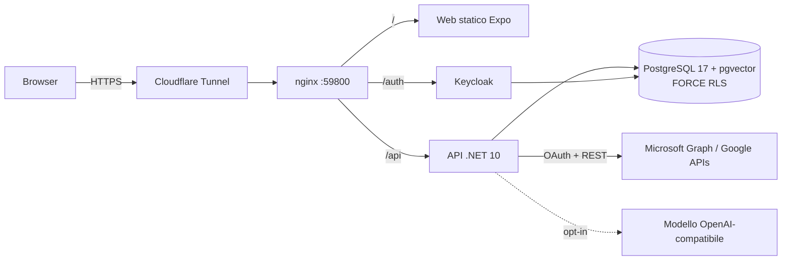

# Tao · 道

**Tao è un assistente personale di lavoro, self-hosted.** Si apre come una chat. Una
configurazione guidata gli dice quali account hai (Microsoft, Google, anche più di uno) e cosa può
fare per te. Poi legge al momento calendario, email, attività e chat, e ti presenta la giornata come
un mazzo di carte da smistare: *fatto*, *non fatto*, *dopo*, *scarta*. Le azioni sulle tue app
avvengono solo quando le confermi, e restano in un audit.

> Stato: **prima release in sviluppo** (v0.4). Pensata per girare on-prem su un tuo server, dietro
> un Cloudflare Tunnel. Prima di usarla con dati di lavoro reali leggi [docs/security.md](docs/security.md).

## Cosa fa oggi

| Funzione | Dettaglio |
|---|---|
| **Chat** | La schermata iniziale. Tao apre con una domanda, oppure con spunti dai giorni precedenti (carte fatte o rimandate). Capisce poche richieste fisse per parole chiave (*oggi*, *piano*, *nota*, *impostazioni*): niente AI. |
| **Configurazione guidata** | Il bottone ✨ fa domande fisse, senza AI: account Microsoft o Google (lavoro o personale), Outlook, Teams, To Do, Gmail, Calendar e Tasks, altri account, CRM, orari, modalità dell'agente. Le risposte diventano le impostazioni, salvate sigillate su PostgreSQL. Alla fine Tao propone di collegare ogni account. |
| **Impostazioni e deleghe** | In alto a destra: il tuo account Tao, la configurazione e, per ogni account, cosa l'agente può leggere o fare per tuo conto. Le categorie non delegate non vengono mai lette dal provider. |
| **Accesso con Google o Microsoft** | Opzionale (`TAO_SOCIAL_LOGIN`), tramite Keycloak: il primo accesso crea l'utente, riconosciuto poi dalla sua e-mail. Un secondo provider con la stessa e-mail si collega solo dopo una prova. `TAO_SOCIAL_SIGNUP=invite` limita l'accesso agli utenti già esistenti. |
| **Oggi** (deck) | Una carta alla volta, ordinata per priorità deterministica e spiegabile (niente AI). Swipe a destra = fatto, a sinistra = non fatto; *Dopo* la rimette in coda dopo 2 ore. |
| **Connettori** | Microsoft 365 (Graph: calendario, posta non letta/contrassegnata, To Do, chat Teams) e Google Workspace (Calendar, Gmail, Tasks). OAuth con PKCE, client confidenziale lato server, token sigillati (AES-256-GCM). |
| **Azioni con conferma** | Completare un'attività su Microsoft To Do / Google Tasks solo con la spunta esplicita sulla carta; ogni tentativo è registrato. |
| **Piano del giorno (AI)** | Opzionale: un modello OpenAI-compatibile (OpenAI, Azure OpenAI, Ollama locale) propone il focus del giorno e una pre-azione per le carte più importanti. Consenso dedicato, dati minimizzati, output mai salvato. |
| **Note** | Cattura rapida di note sigillate nel database, con consenso, retention di 30 giorni, timeline filtrabile. |
| **Privacy** | Vista *Note e privacy*: export JSON completo e cancellazione dei tuoi dati (note, consensi, impostazioni, account collegati, decisioni, audit). |
| **Voce** | Dettatura e voce di Tao nel browser (Web Speech API), instradate da un router AI: oggi `browser`, domani un motore sul server senza toccare la chat. Consenso dedicato `speech.browser`, perché il fornitore del browser può elaborare audio o testo fuori dal dispositivo ([ADR 0102](adr/0102-immersive-chat-ai-router-and-browser-speech.md)). |
| **Lingue** | 21 lingue (italiano, inglese, spagnolo, francese, tedesco, portoghese, russo, polacco, olandese, turco, indonesiano, vietnamita, cinese, giapponese, coreano, thai, hindi, bengalese, arabo, urdu, persiano), anche da destra a sinistra. La scelta resta solo nel browser; il piano del giorno è scritto nella stessa lingua ([ADR 0103](adr/0103-internationalization-21-languages.md), [docs/i18n.md](docs/i18n.md)). |
| **Effetti** | Il saluto esce dal fumo, i pulsanti emergono e pulsano, il simbolo gira, inverte e si capovolge a caso. Solo sul web e mai con il movimento ridotto. |
| **Demo** | La build statica su [GitHub Pages](https://keyserdsoze.github.io/Tao/) mostra la chat, la configurazione guidata e il deck con dati di esempio, senza backend e senza salvare nulla. |

Non ancora disponibile (vedi [docs/roadmap.md](docs/roadmap.md)): uso vocale in cuffia con motore sul server, ping e
notifiche, memoria giornaliera da CRM/transcript, flussi di business definiti da te, profilo di
stile comunicativo, client desktop.

## Architettura in breve



Un'unica porta (59800) espone web, API e login. Dettagli in [docs/architecture.md](docs/architecture.md).

## Avvio on-prem

Requisiti: Docker con Compose v2, `openssl` (solo per `setup.sh`).

```sh
# 1. Configurazione: segreti casuali + key ring di cifratura (fare il backup di docker/secrets!)
docker/setup.sh https://tao.example.com        # oppure: docker/setup.sh  (default http://localhost:59800)
# Windows: ./docker/setup.ps1 -PublicUrl https://tao.example.com

# 2. Avvio
docker compose --env-file docker/.env -f docker/compose.yml up -d --build

# 3. Primo utente: console Keycloak, raggiungibile SOLO dall'host
#    http://localhost:59801/auth/admin  (credenziali KEYCLOAK_ADMIN* in docker/.env)
#    realm "tao" -> Users -> Add user -> Credentials -> Set password
```

Poi apri `TAO_PUBLIC_URL` (in locale `http://localhost:59800`) e accedi.

- **Porte**: `59800` gateway (web `/`, API `/api`, login `/auth`), legata a `127.0.0.1` per default
  (`TAO_HTTP_BIND=0.0.0.0` per la LAN); `59801` console Keycloak, solo host.
- **URL pubblico**: `TAO_PUBLIC_URL` definisce issuer OIDC, redirect del login e dei connettori.
  Impostalo **prima del primo avvio**: il realm viene importato una sola volta. Per cambiarlo dopo,
  aggiorna redirect URI e web origins del client `tao-web` dalla console Keycloak.
- **Modello AI locale** (opzionale): `docker compose ... --profile ollama up -d`, poi
  `LLM_ENDPOINT=http://ollama:11434/v1` e `LLM_MODEL=<modello scaricato>` in `docker/.env`.

### Cloudflare Tunnel

```sh
# Tunnel rapido (URL casuale, utile per prove)
cloudflared tunnel --url http://127.0.0.1:59800
# Tunnel con nome e dominio: ingress verso http://127.0.0.1:59800
cloudflared tunnel create tao
cloudflared tunnel route dns tao tao.example.com
cloudflared tunnel run --url http://127.0.0.1:59800 tao
```

nginx accetta l'header `X-Forwarded-Proto: https` dal tunnel e abilita HSTS solo in quel caso.
Valuta Cloudflare Access davanti a Tao come secondo fattore.

### Connettori, accesso social e assistente

- Registrazione app Microsoft Entra e Google Cloud, permessi e redirect URI:
  [docs/connectors.md](docs/connectors.md).
- Accesso con Google o Microsoft sull'account Tao: `TAO_SOCIAL_LOGIN=google,microsoft` in
  `docker/.env`, con le stesse app dei connettori. Aggiungi il redirect URI
  `${TAO_PUBLIC_URL}/auth/realms/tao/broker/<google|microsoft>/endpoint`. Il servizio
  `keycloak-config` applica la configurazione a ogni avvio. Di default (`TAO_SOCIAL_SIGNUP=open`) il
  primo accesso crea l'utente; con `invite` servono utenti già creati in Keycloak. Opzioni:
  `GOOGLE_HOSTED_DOMAIN`, `MICROSOFT_TENANT` (vedi [docs/security.md](docs/security.md) e ADR 0104).
- Configurazione e privacy del piano del giorno: [docs/assistant.md](docs/assistant.md).

## Sviluppo

```sh
# Web (Expo SDK 58)
cd src/mobile && npm ci && npm run typecheck && npm test && npm run build:web && npm run test:e2e

# Backend (.NET SDK 10.0.404, vedi global.json)
dotnet test tests/Tao.Domain.Tests/Tao.Domain.Tests.csproj
# Integrazione su PostgreSQL reale (ruoli tao_app / tao_retention, vedi .github/workflows/ci.yml)
TAO_TEST_DB=... TAO_TEST_APP_DB=... TAO_TEST_RETENTION_DB=... TAO_TEST_KEYRING_FILE=... \
  dotnet test tests/Tao.Integration.Tests/Tao.Integration.Tests.csproj

# E2E sul gateway completo (stack compose avviato, utente Keycloak di test)
cd src/mobile && TAO_GATEWAY_E2E=1 TAO_E2E_BASE_URL=http://localhost:59800 \
  TAO_E2E_USER1=... TAO_E2E_PASSWORD=... npx playwright test e2e/gateway.spec.ts
```

Strategia di test: [docs/testing-strategy.md](docs/testing-strategy.md). Regole per chi contribuisce
(anche agenti AI): [AGENTS.md](AGENTS.md).

## Repository

```text
src/backend/Tao.Domain          invarianti: memoria, consensi, carte di lavoro, triage, impostazioni
src/backend/Tao.Application     casi d'uso e porte (connettori, oggi, impostazioni, assistente, privacy)
src/backend/Tao.Infrastructure  PostgreSQL (migrazioni, RLS), Graph/Google, modello AI, cifratura
src/backend/Tao.Api             REST /api/v1, OIDC JWT, limiti, DI
src/mobile                      Expo Router: web statico (gateway e Pages), iOS/Android
tests/                          xUnit (unit + PostgreSQL), Vitest; Playwright in src/mobile/e2e
docker/                         compose on-prem, nginx, Keycloak realm, setup
docs/, adr/                     architettura, sicurezza, privacy, decisioni
infra/azure                     template Bicep opzionale (non validato)
```

La storia della fase di ricerca precedente (progetto "Omnia": disaster recovery, supply-chain
gates) è conservata nel tag `archive/omnia-dr-research`; vedi [ADR 0098](adr/0098-tao-pivot-onprem-first-release.md).
