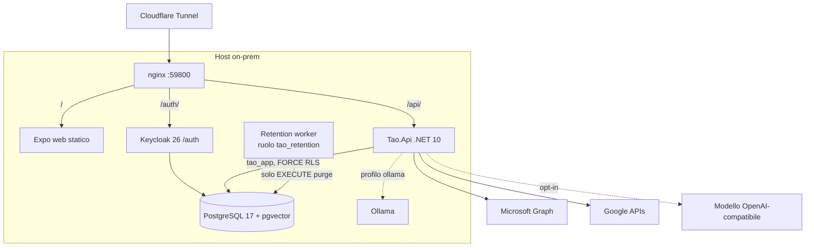

# Architettura di Tao

Stato: v0.4 (prima release on-prem). Decisioni: [ADR 0098](../adr/0098-tao-pivot-onprem-first-release.md),
[0099](../adr/0099-work-connectors-and-daily-deck.md), [0100](../adr/0100-assistant-briefing-openai-compatible.md),
[0101](../adr/0101-chat-first-scripted-setup-and-delegations.md).

## Vista d'insieme

- **Un'unica origine**: web, API e login sulla stessa porta; nessun CORS in produzione, cookie
  Keycloak di prima parte, CSP stretta (`script-src 'self'` + hash dello script di idratazione Expo).
- **Keycloak** in modalità produzione con `--http-relative-path=/auth`, hostname = `TAO_PUBLIC_URL/auth`,
  console admin solo su `localhost:59801`. Il realm `tao` emette `tenant_id` (costante
  dell'installazione) e l'audience `tao-api`. Il servizio one-shot `keycloak-config` (kcadm,
  idempotente) abilita o disabilita a ogni avvio l'accesso con Google/Microsoft (`TAO_SOCIAL_LOGIN`)
  con un flusso di primo accesso solo su invito.
- **API** valida i JWT (issuer pubblico, metadata via rete interna `http://keycloak:8080`).

## Backend: moduli

| Progetto | Responsabilità |
|---|---|
| `Tao.Domain` | `MemoryEntry`, `ConsentGrant` (scopi `memory.capture`, `assistant.briefing`), `WorkItem`, chiavi delle carte, priorità deterministica, decisioni di triage, `UserSettings` (account dichiarati, deleghe, modalità dell'agente) |
| `Tao.Application` | casi d'uso e porte: `MemoryCatalog`, `ConsentService`, `PersonalDataService`, `ConnectorService`, `SettingsService`, `TodayService`, `DailyBriefingService`, `IEnvelopeEncryption`, `IConnectorProvider`, `ISettingsStore`, `IChatModel` |
| `Tao.Infrastructure` | PostgreSQL (migrazioni embedded, `PostgresActorScope`, guardie di runtime), connettori Graph/Google, modello OpenAI-compatibile, cifratura AES-256-GCM a busta, embeddings |
| `Tao.Api` | minimal API `/api/v1`, OIDC/JWT, limiti (rate per attore/tenant, budget body JSON, Kestrel), `Cache-Control: no-store`, retention worker |

## Dati e isolamento

- Tre identità PostgreSQL distinte: **owner** (migrazioni), **`tao_app`** (API, senza BYPASSRLS,
  senza TRUNCATE, non owner), **`tao_retention`** (solo `EXECUTE` sulle funzioni di purge). L'API
  verifica queste proprietà all'avvio e si rifiuta di partire se non valgono.
- Ogni tabella personale ha **FORCE RLS** su `tenant_id`/`owner_sub` letti dai GUC
  `tao.tenant_id`/`tao.owner_sub`, impostati per transazione da `PostgresActorScope` con i valori
  del JWT. Le scritture concorrenti dello stesso attore sono serializzate da un advisory lock.
- Tabelle: `memory_entries`, `consent_grants`, `connector_authorizations`, `connector_accounts`,
  `triage_decisions`, `connector_actions`, `user_settings` (elenco in
  `PostgresRuntimeGuard.PersonalTables`).
- **Sigillatura**: payload delle note, impostazioni, verifier PKCE e credenziali OAuth sono buste
  AES-256-GCM (DEK per record, KEK dal key ring `TAO1`), AAD = tenant + owner + scopo + id della riga.
  Il key ring è un file montato in sola lettura (`docker/secrets/envelope.keyring.json`).
- **Retention**: note 30 giorni, decisioni 30 giorni, audit 180 giorni, autorizzazioni OAuth
  10 minuti; purge a lotti `SKIP LOCKED` ogni 15 minuti tramite funzioni `SECURITY DEFINER`.
- Migrazioni `NNNN_name.sql` append-only con checksum; una migrazione già applicata non si modifica.

## Flussi principali

1. **Login**: Authorization Code + PKCE S256 dal browser (oidc-client-ts), token solo in memoria.
   I bottoni Google/Microsoft passano `kc_idp_hint` a Keycloak; l'API vede sempre e solo il JWT
   del realm `tao`.
2. **Configurazione guidata** (senza AI): uno script fisso nel client (`setupFlow.ts`) compone le
   impostazioni; `PUT /api/v1/settings` le valida nel dominio e le salva sigillate in
   `user_settings` (un documento per attore). I collegamenti `connectedAccountId` vengono accettati
   solo se puntano ad account dello stesso attore e dello stesso provider.
3. **Note**: consenso `memory.capture` → cattura → payload sigillato → timeline paginata (keyset).
4. **Connettori**: vedi [connectors.md](connectors.md). Lettura live, nessuna copia dei contenuti.
5. **Oggi**: `GET /api/v1/today` interroga in parallelo ogni account, chiedendo al provider solo le
   categorie delegate (account senza deleghe di lettura: stato `paused`, nessuna chiamata), unisce,
   deduplica, assegna la priorità e allega le decisioni; `POST /api/v1/today/decisions` salva la
   decisione ed eventualmente completa il task alla fonte (solo con delega `tasks.complete`, conferma
   esplicita e audit). `GET /api/v1/today/recap` conta le decisioni degli ultimi giorni per gli
   spunti della chat.
6. **Piano del giorno**: vedi [assistant.md](assistant.md).
7. **Diritti**: export JSON in streaming e cancellazione transazionale di tutte le tabelle
   personali; prima della cancellazione l'API revoca (best effort) i grant dei provider.

## Frontend

Expo SDK 58 + Expo Router, un'unica base di codice per web (export statico), iOS e Android.
Modalità: **stessa origine** (gateway, `EXPO_PUBLIC_TAO_SAME_ORIGIN=true`), **cloud** con
issuer/API espliciti, **demo** (Pages, nessun backend, deck sintetico, niente salvato).
Tre viste: **chat** (`ChatHome`, la home; deck e piano del giorno compaiono come widget nella
chat), **impostazioni** (`SettingsPanel`, avatar in alto a destra: account, deleghe per account,
`ConnectionsPanel`), **note e privacy** (timeline, consensi, export, cancellazione). La chat resta
montata mentre si cambia vista. Logica pura e testata con Vitest: `setupFlow.ts` (domande e
risposte ammesse), `chatScript.ts` (parole chiave, saluto, spunti). Rotta `/connections/callback`
per i popup OAuth. Le risposte di una sessione chiusa non possono aggiornare la UI (epoch di sessione).

## Limiti noti

- Nessuna alta disponibilità: un solo host, backup a cura dell'operatore (epic #221).
- Lettura live: nessuna sincronizzazione delta né webhook (epic #222).
- Key ring su file, senza HSM/Key Vault; rotazione manuale via rewrap.
